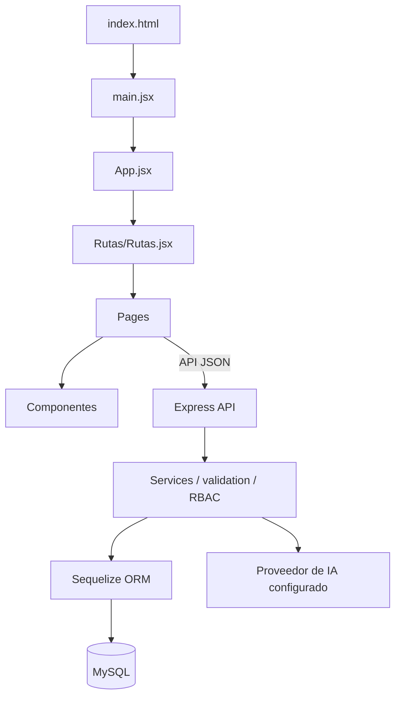

# Arquitectura — React + Node.js/Express + Sequelize + MySQL

## Decisión
**Monolito modular** con un backend Express y frontend React/Vite en JavaScript. Persistencia real MySQL 8+ **únicamente a través de Sequelize ORM**, migrations CLI y asociaciones explícitas. IA externa opcional configurada desde el backend.

## Frontend: rutas obligatorias
`frontend/index.html` → `frontend/src/main.jsx` → `frontend/src/App.jsx` → `frontend/src/Rutas/Rutas.jsx` → `frontend/src/Pages/*` → `frontend/src/Componentes/*`.
Se pueden añadir `services/`, `hooks/`, `context/`, `assets/` y subcarpetas, pero las carpetas/archivos anteriores conservan esos nombres y ubicaciones. Páginas: login, inicio, estudiantes, docentes, administración, cursos, evaluaciones, tutor, progreso y planificador. Todos los datos vienen del backend, sin arrays académicos hardcodeados.

## Backend
`backend/src/app.js` monta middlewares y rutas; `server.js` arranca API; `config/database.js` construye Sequelize leyendo `.env` y `backend/config/db.json` sin secretos; `models/` declara entidades y asociaciones; `controllers/` maneja HTTP; `services/` reglas de negocio; `routes/` Express Router; `middlewares/` auth/errores; `validators/` payloads. `backend/database/migrations` versiona el esquema.

Flujo: `HTTP → autenticación → autorización contextual + tenant guard → validación → service → Sequelize model → MySQL`. Sequelize transactions para operaciones críticas; migraciones sin `force` ni seeder de datos.

## Configuración local
- React/Vite: puerto 5173 (o equivalente).
- Express: puerto 3001 (o equivalente).
- MySQL: DB vacía creada por operador, migraciones para tablas/índices.
- Variables `DB_HOST`, `DB_PORT`, `DB_NAME`, `DB_USER`, `DB_PASSWORD`, `PORT`, `AI_PROVIDER`, `AI_API_KEY` permanecen server-side; `.env.example` no contiene secretos.
- Si IA no está configurada, tutor devuelve `AI_NOT_CONFIGURED`, sin inventar respuestas.

## IA y aprendizaje adaptativo
El algoritmo de dominio es determinista y comprobable; el LLM interpreta y genera explicaciones contextualizadas en lecciones autorizadas. Citas a fuentes reales, mitigación de prompt injection, costos y límites. No se permiten cambios de nota oficial exclusivamente por IA.

## Evolución
Colas Redis/BullMQ para PDFs, almacenamiento de materiales, indexación vectorial y observabilidad más adelante. Evitar microservicios prematuros.
