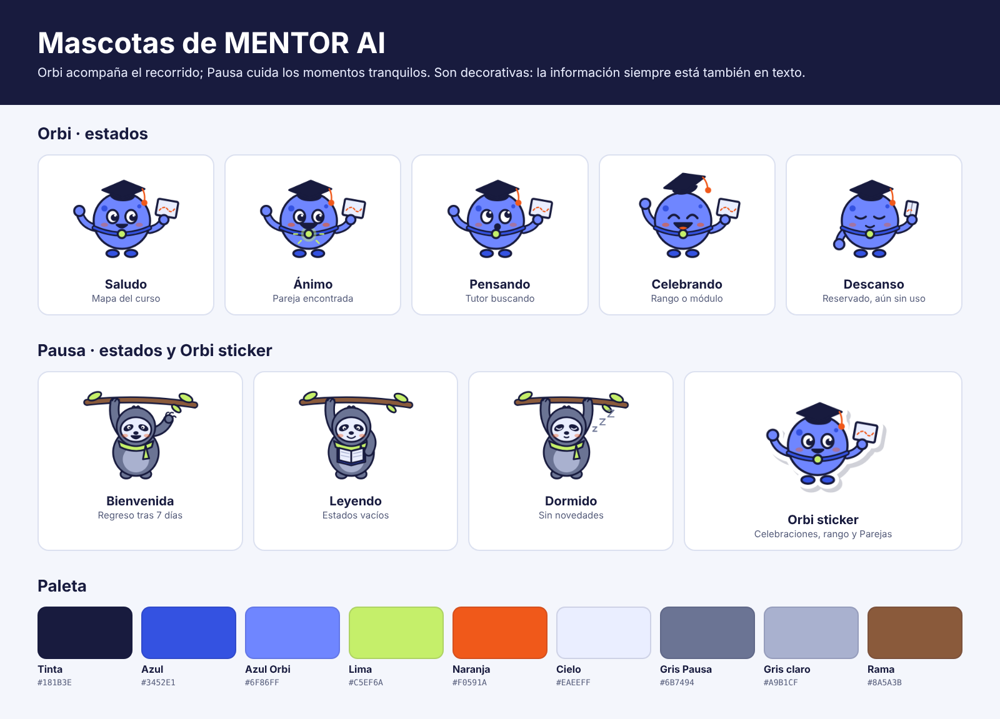

# Mascotas de MENTOR AI · Orbi y Pausa

## Quiénes son
- **Orbi** (principal): un planeta con birrete, cinturón con hebilla lima y un mapa con el camino punteado. Acompaña el recorrido del curso: el mapa, el rango, Parejas, las celebraciones y el tutor.
- **Pausa** (bienestar): un perezoso colgado de una rama, con bufanda lima. Aparece en los momentos tranquilos: el saludo de la portada, la bienvenida de regreso, los estados vacíos y el aviso de «Menos movimiento».

## Archivos
| Archivo | Uso |
|---|---|
| `orbi.svg`, `pausa.svg` | Dibujos de referencia oficiales |
| `orbi-sticker.svg` | Orbi como calcomanía (sombra, papel troquelado y dibujo) |
| `estados/*.png`, `estados/*.svg` | Un archivo por estado, exportado desde los mismos componentes de la app (`node frontend/scripts/exportar-mascotas.mjs`); los de Pausa paseante se llaman `pausa-paseante-*` |
| `ficha-mascotas.png` | Esta lámina (`node frontend/scripts/ficha-mascotas.mjs`) |

En la app se dibujan con `Componentes/Orbi.jsx`, `Pausa.jsx`, `OrbiSticker.jsx` y el envoltorio `Mascota.jsx`. Los textos están en `utils/mensajesMascota.js`; las frases de Pausa paseante, en `utils/frasesPausa.js`.

## Estados
| Personaje | Estado | Dónde |
|---|---|---|
| Orbi | Saludo | Mapa del curso, junto a la parada siguiente |
| Orbi | Ánimo | Parejas, al encontrar una pareja |
| Orbi | Pensando | Tutor IA, mientras busca en el material |
| Orbi | Celebrando | Subir de rango, terminar un módulo, recorrido completo |
| Orbi | Descanso | Reservado, aún sin uso en pantalla |
| Pausa | Bienvenida | Portada pública (iniciar sesión, recuperar y activar), agarrada con una mano del borde inferior de la barra del logo y sin su rama (`rama={false}`); inicio del estudiante tras 7 días o más sin actividad de aprendizaje |
| Pausa | Leyendo | Estados vacíos (sin cursos, curso sin lecciones) y Configuración |
| Pausa | Dormido | Sin novedades, módulo sin lecciones o sin preguntas de práctica; Configuración con «Menos movimiento»; Pausa paseante cuando descansa o tras tres caricias |
| Pausa | Curioso | Pausa paseante: al tocarlo, con un dato curioso |
| Pausa | Molesto / Enojado | Pausa paseante: muchos clics seguidos (niveles 1 y 2) |
| Pausa | Tapado | Pausa paseante: nivel 3 de molestia; se tapa la cara y se aleja |
| Pausa | Feliz | Pausa paseante: caricia (ojos cerrados, rubor y corazones lima) |
| Pausa | Bostezo | Pausa paseante: mientras descansa y al despertar |

Los estados cambian partes del mismo dibujo (ojos, boca, brazo, birrete, mapa). No hay una imagen distinta por estado.

## Pausa paseante
Para estudiantes, en su inicio, sus cursos, el mapa y Parejas: cuelga con las dos manos del borde inferior de la barra superior y avanza mano tras mano, muy despacio. No se detiene encima del foco, de los campos ni del botón principal, y se queda quieto si el puntero se acerca. Al tocarlo cuenta un dato curioso real; con muchos clics seguidos se molesta (con humor amable) y una caricia en la cabeza lo pone feliz. Se apaga o se esconde por hoy desde Configuración. Detalle en el anexo de `docs/adr/0010-mapa-rango-mascotas-parejas.md`.

## Tamaños
- Pequeño (48 px): avisos y el tutor.
- Mediano (120 px): tarjetas y la bienvenida.
- Grande (200 px): celebraciones.
- Pausa se dibuja un 35 % más ancha porque la rama ocupa espacio. Así el personaje mide lo mismo que Orbi.

## Paleta
Tinta `#181B3E`, azul `#3452E1`, azul Orbi `#6F86FF`, lima `#C5EF6A`, naranja `#F0591A`, cielo `#EAEEFF`, gris Pausa `#6B7494`, gris claro `#A9B1CF`, rama `#8A5A3B`. En tema oscuro, un halo claro mantiene visible el contorno tinta.

## Sticker de papel
- **Pegar**: al aparecer una celebración, al entrar a Parejas y al completar el tablero.
- **Despegar la esquina**: insignia del rango en el encabezado, con el mouse o con el foco del teclado.
- **Doblar**: en la celebración, para pasar del logro a «qué sigue».
- **Arrugar y alisar**: pareja fallida en Parejas y respuesta incorrecta en la práctica diaria; al alisarse, Orbi sonríe.
- **Saltar**: pareja encontrada en Parejas y acierto en la práctica diaria.
- **Volar**: al cerrar una celebración.

Cada animación dura menos de 1 segundo y no bloquea la página. Con «Menos movimiento» solo hay un fundido o el cambio directo.

## Usos correctos
- Acompañar un logro real (lección completada, tarea entregada, módulo terminado, rango nuevo), con el dato en texto al lado.
- Dar un mensaje corto, amable y con datos reales: «Te falta 1 lección para Luz».
- Respetar la preferencia «Mostrar mascotas». Cuando se ocultan, el mensaje importante queda como texto normal.
- Marcar el dibujo como decorativo (`aria-hidden`). El texto de la burbuja es el que lee el lector de pantalla.

## Usos incorrectos
- En evaluaciones o en el quiz con bono: ahí distraen y pueden sentirse como presión.
- Para regañar, amenazar con perder la racha o crear urgencias falsas.
- Como única forma de dar una información (sin texto al lado).
- Deformadas, con otros colores o recortadas sin su contorno.
- Con movimiento continuo que no se detenga con «Menos movimiento», con la pestaña oculta o desde su interruptor. El movimiento de reposo y el paseo de Pausa están permitidos solo así (decisión del 2026-11-27).
- Con datos inventados o de demostración.
